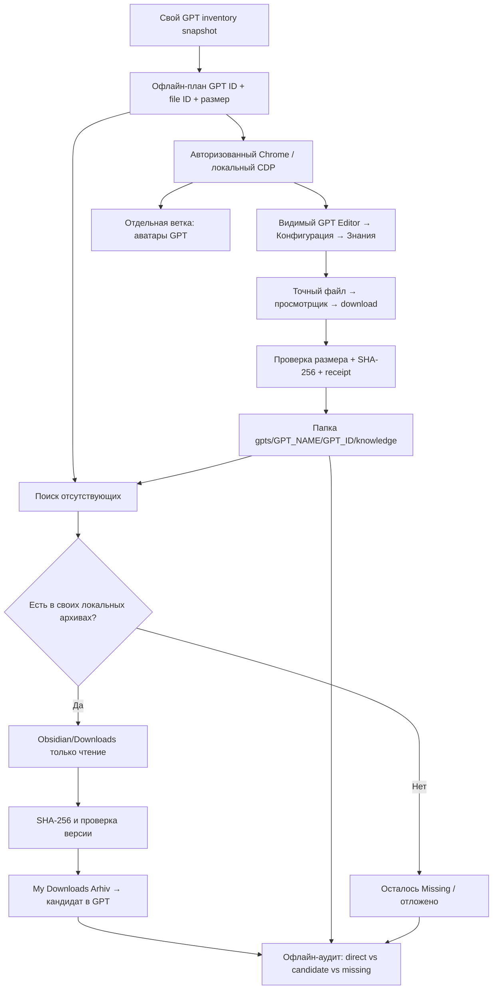

# Архитектура воспроизводимого процесса

## Границы доверия

**ChatGPT UI:** только чтение контента/скачивание; нельзя автоматически менять GPT. HTTP-ограничения останавливают обход.

**Snapshot:** необходимая привязка имени Knowledge к конкретным GPT ID, file ID и ordinal. Snapshot *сам* не удостоверяет содержимое на сервере.

**Backup:** локальный приватный каталог; основной файл пишется без перезаписи и с журналом provenance.

**Obsidian/локальные архивы:** только чтение, SHA-256 до и после копирования. Локальные источники не объявляются подтверждёнными экземплярами удалённого GPT.

**GitHub:** только код, синтетические примеры и обезличенные агрегированные результаты. Никаких файлов из приватного backup.
